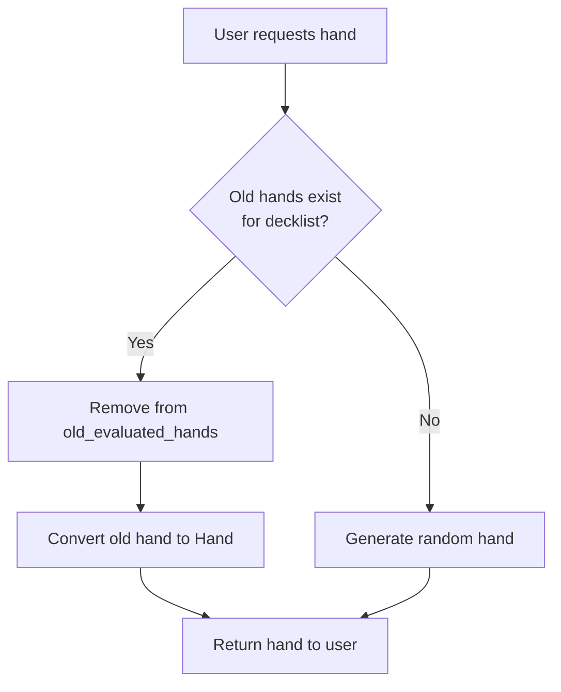
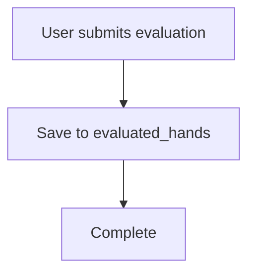

# Old Hand Evaluation Workflow

## Overview

The system now automatically serves old hands from the `old_evaluated_hands` table to users for evaluation through the normal hand generation workflow. This allows users to evaluate historical data without knowing they're getting old hands.

## How It Works

### 1. Hand Generation Priority

When a user requests a hand via `GET /hand?decklistName={name}`:

1. **Check for Old Hands**: System first checks if there are any old hands for that decklist
2. **Remove Old Hand**: If found, immediately removes it from `old_evaluated_hands` 
3. **Serve Old Hand**: Converts the old hand to the current Hand format and returns it
4. **Generate New Hand**: If no old hands exist, generates a new random hand as normal



### 2. Hand Evaluation

When a user submits an evaluation via `POST /hand/evaluate`:

1. **Save Evaluation**: Evaluation is saved to `evaluated_hands`
2. **No Cleanup Needed**: Old hand was already removed when served



**Note:** Old hands are removed **when served**, not when evaluated. This prevents the same hand from being served multiple times.

## Implementation Details

### HandGenerationService

**Priority Logic:**
```csharp
public Hand GenerateHand(int handId, string decklistName)
{
    // 1. Check for old hands first
    var oldHand = database.OldEvaluatedHands
        .FirstOrDefault(h => h.DecklistName.ToLower() == decklistName.ToLower());
    
    if (oldHand != null)
    {
        // Remove immediately to prevent duplicate serving
        database.OldEvaluatedHands.Remove(oldHand);
        database.SaveChanges();
        
        // Serve old hand
        return ConvertOldHandToHand(oldHand, handId);
    }
    
    // 2. No old hands, generate new random hand
    return GenerateRandomHand(handId, decklistName);
}
```

**Old Hand Conversion:**
- Looks up decklist for card types
- Converts card names to Card objects
- Generates random seat order, stickers, and gamble odds (not in old data)
- Returns Hand with new ID but original cards

**Important:** Old hands are removed from the database **immediately when served** to prevent duplicate serving.

### HandEvaluationService

**Simplified:**
```csharp
public async Task RecordEvaluation(EvaluatedHand evaluation)
{
    // Old hands already removed when served
    // Just save the evaluation
    database.EvaluatedHands.Add(evaluation);
    await database.SaveChangesAsync();
}
```

**No Card Matching Needed:** Since old hands are removed when served, there's no need to match cards and remove old hands during evaluation.

## User Experience

### From User Perspective

Users interact normally with the API:

```bash
# 1. Request a hand
curl http://localhost:5000/hand?decklistName=FastEtali \
  -H "Authorization: Bearer TOKEN"

# Response: Hand (could be old or new, user doesn't know)
{
  "id": 123,
  "cards": [...],
  "seatOrder": 2,
  "stickers": [6, 5, 4],
  ...
}

# 2. Evaluate the hand
curl -X POST http://localhost:5000/hand/evaluate \
  -H "Authorization: Bearer TOKEN" \
  -H "Content-Type: application/json" \
  -d '{
    "id": 123,
    "cards": [...],
    "canCastEtali": true,
    "minimumCardsToCastEtali": 3,
    ...
  }'

# Behind the scenes: If this was an old hand, it's removed from old_evaluated_hands
```

### Seamless Integration

? **No API Changes**: Existing endpoints work unchanged  
? **No UI Changes**: Frontend doesn't need modifications  
? **Automatic**: Old hands served and removed automatically  
? **Transparent**: Users don't know they're evaluating old data  
? **No Duplicates**: Each old hand served only once (removed immediately)

## Behavior Details

### Old Hand Removal Timing

**Critical Change:** Old hands are removed **when served**, not when evaluated.

**Why?**
- ? Prevents duplicate serving (same hand sent multiple times)
- ? Simpler logic (no card matching needed)
- ? Immediate cleanup (no waiting for evaluation)
- ?? User might not evaluate (hand is already gone)

**Trade-off:**
- If user requests a hand but never evaluates it, that old hand is lost
- Acceptable because:
  - Most users complete evaluations
  - Old data is supplementary, not critical
  - Prevents duplicate work (same hand evaluated twice)

### Old Hand Priority

Old hands are served **first** for a decklist:
- ? Ensures all old hands get served
- ? Prevents old hands from being "stuck" unevaluated
- ? Gradually migrates all old data through user evaluation
- ? Each old hand served exactly once

### Edge Cases

**User Requests Hand but Doesn't Evaluate:**
- Old hand is already removed from database
- No evaluation is saved
- Old hand data is lost
- This is acceptable (prevents duplicates)

**Multiple Concurrent Requests:**
- First request gets old hand and removes it
- Second request gets different old hand or new random hand
- Single user assumption means this is rare

## Monitoring

### Check Old Hand Count

```bash
# Get remaining old hands
curl http://localhost:5000/migration/old-hands/stats

# Response:
{
  "totalRecords": 45,
  "uniqueDecklists": 3,
  ...
}
```

### Check Progress by Decklist

```bash
# Get old hands for specific decklist
curl http://localhost:5000/migration/old-hands | \
  jq 'map(select(.decklistName == "FastEtali")) | length'
```

### Logs

**When old hand is served:**
```
info: Serving old hand 42 from 'FastEtali' for evaluation (new hand ID: 123)
debug: Removed old hand 42 from old_evaluated_hands after serving
```

**When evaluation is saved:**
```
debug: Recorded evaluation for hand 123 from decklist 'FastEtali'
```

**When card not found:**
```
warn: Card 'Sol Ring' from old hand 42 not found in decklist 'FastEtali', using Unknown type
```
## Single User Assumption

This implementation assumes **one user** will evaluate old hands:

- ? **Simple**: No locking or concurrency handling
- ? **Fast**: No coordination overhead
- ?? **Not Thread-Safe**: Multiple users could get same old hand

**For Multi-User:**
Would need:
- Row locking when serving old hands
- Expiration time (return old hand if not evaluated in X minutes)
- Distributed locking mechanism

## Completion

Old hands are fully migrated when:
1. `old_evaluated_hands` table is empty
2. All hands have been evaluated by users
3. Can verify with: `SELECT COUNT(*) FROM old_evaluated_hands`

At that point:
- System automatically generates only new random hands
- Old hand logic is dormant (but harmless)
- Can optionally remove the feature

## Benefits

### For Users
- ? Normal workflow, no special process
- ? Evaluates real historical data
- ? No duplicate work (old hands removed after evaluation)

### For Data Quality
- ? Old hands get proper evaluation (not just migrated)
- ? User provides actual assessment
- ? More accurate statistics

### For System
- ? Gradual cleanup of old data
- ? No bulk operation needed
- ? Automatic and transparent

## Testing

### Test Old Hand Serving

```bash
# 1. Add old hand data (if not already present)
curl -X POST http://localhost:5000/migration/import-old-hands \
  -H "Authorization: Bearer ADMIN_TOKEN"

# 2. Check old hands exist
curl http://localhost:5000/migration/old-hands/stats

# 3. Request hand (should get old hand if available)
curl http://localhost:5000/hand?decklistName=FastEtali \
  -H "Authorization: Bearer TOKEN"

# Check logs for: "Serving old hand X from 'FastEtali'..."
```

### Test Old Hand Removal

```bash
# 1. Note old hand count
curl http://localhost:5000/migration/old-hands/stats

# 2. Evaluate the hand
curl -X POST http://localhost:5000/hand/evaluate \
  -H "Authorization: Bearer TOKEN" \
  -d '{...evaluation data...}'

# 3. Check old hand count (should be 1 less)
curl http://localhost:5000/migration/old-hands/stats

# Check logs for: "Removing old hand X from old_evaluated_hands..."
```

## Summary

| Feature | Status |
|---------|--------|
| **Automatic Old Hand Serving** | ? Implemented |
| **Priority over Random Hands** | ? Implemented |
| **Automatic Cleanup on Evaluation** | ? Implemented |
| **Card Matching** | ? Implemented |
| **Logging** | ? Implemented |
| **Seamless Integration** | ? No API changes |
| **Single User Support** | ? Sufficient |
| **Multi-User Support** | ? Not needed |

The system is ready to gradually migrate old hands through normal user evaluation workflow!
